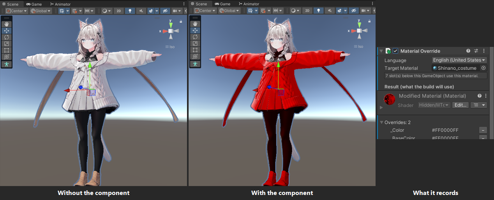
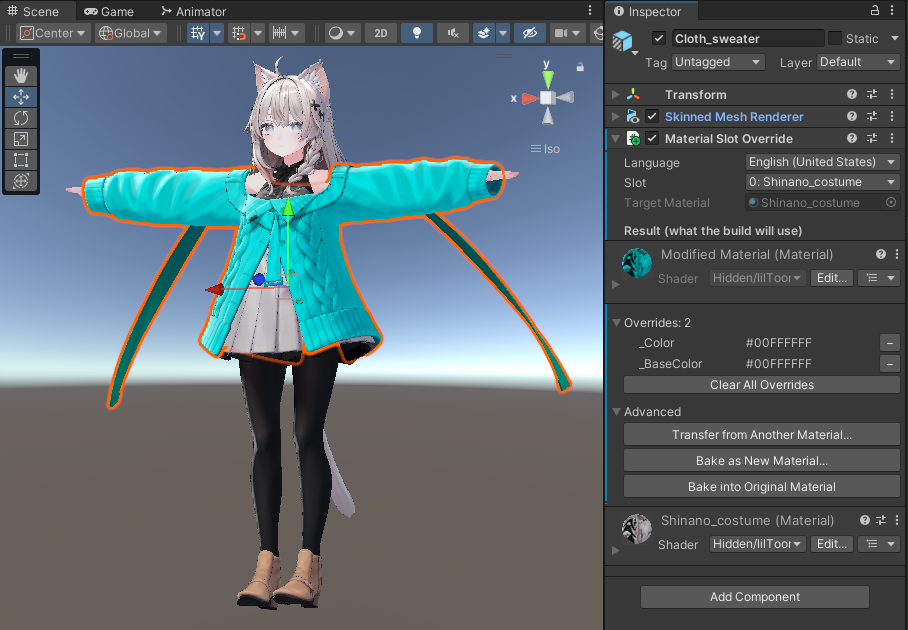
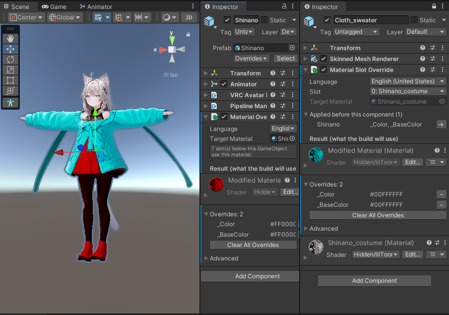
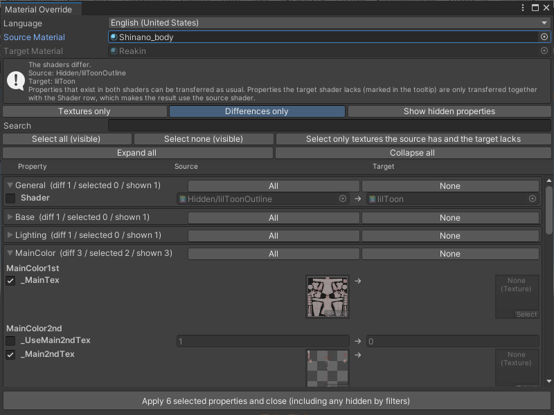

# Material Override

[English](README.md) | **繁體中文**

在不動材質資產的情況下，修改 VRChat Avatar 上的材質。你只需要記錄和原始材質不同的部分，變更會在 Avatar 建置（NDMF）時才套用。

- **非破壞性**：不會建立或修改任何材質資產。Inspector 只顯示你改過的內容，移除元件就等於移除變更。需要的話，也可以把結果烘焙成新的材質資產。
- **兩種元件**：**Material Override** 會修改 GameObject 底下所有使用指定材質的槽位（例如身體、衣服和配件共用的同一個材質）。**Material Slot Override** 只修改某個 Renderer 的某一個槽位。
- **可疊加**：父物件上的元件先套用，再來是子物件，最後是槽位自己的元件。每一層都以前一層的結果為基礎，所以子物件可以覆蓋父物件的設定，反過來則不會。
- **支援動畫與 Modular Avatar**：開關、指向原始材質的動畫，以及 Modular Avatar 的 Material Swap，看到的都是最後的材質。
- **建置前就能預覽**：NDMF 的預覽會在場景中顯示結果（Mesh 與 Skinned Mesh Renderer）。
- **不限 shader**：不綁定 lilToon。也可以從另一個材質複製選定的屬性。
- **需求**：Unity 2022.3 與 NDMF 1.13.1 以上。與 TexTransTool（TTT）的相容性尚未驗證。



安裝方式：把 [安裝](#安裝) 一節說明的 VPM 倉庫加到 VCC 或 ALCOM。

## 快速開始

1. 在有 Renderer 的 GameObject 上加 **Material Slot Override** 並選擇 **Slot**，或在任何 GameObject 上加 **Material Override** 並選擇 **Target Material**。兩者都在 Add Component 選單的 **Uto** 分類裡。
2. 在 Inspector 顯示的材質面板中修改想改的內容。只有你改過的部分會被記錄。
3. 照常建置或上傳。想先確認結果，可以看場景裡 NDMF 的預覽。



## 需求

- Unity 2022.3
- [NDMF](https://ndmf.nadena.dev/) 1.13.1 以上
- lilToon 是選用的。轉移視窗對任何 shader 都能使用。安裝 lilToon 時，會依 lilToon 材質面板的方式為屬性分組，否則所有屬性都列在 **Other**。

## 安裝

把這個 VPM 倉庫加到 VCC（2.1.0 以上）或 ALCOM，再把 **Material Override** 加進專案：

```
https://utooooto.github.io/vpm/index.json
```

在 VCC 中：**Settings** > **Packages** > **Add Repository**，貼上網址並確認。

## 元件

兩個元件都在 Add Component 選單的 **Uto** 分類裡。

### Material Override

加在任何 GameObject 上並選擇 **Target Material**。它會套用到該 GameObject 及其底下所有 Renderer 中、使用目標材質的每個槽位。在 Inspector 顯示的材質面板中編輯結果，只有你改過的部分會被記錄。

適合用在要影響多個 Renderer 的修改，例如改動身體、衣服和配件共用的同一個材質的某個屬性。

### Material Slot Override

加在有 Renderer 的 GameObject 上並選擇 **Slot**，它只修改那一個槽位。同一個槽位只能有一個 Material Slot Override；同一個 GameObject 上較後面的那個不會生效，建置時會回報錯誤。

如果之後該槽位的材質被換掉，元件會跟著新材質，並保留已記錄的差異。

## 疊層

一個槽位可能同時受到多個元件影響，由範圍最廣的開始依序套用：

1. 位於 Renderer 所在 GameObject 與其父物件上的 Material Override，父物件優先。同一個 GameObject 上的元件依元件順序套用。
2. 該槽位自己的 Material Slot Override。

每一層都以前一層的結果為起點，所以後面的層會覆蓋前面的層對同一個屬性的設定。父物件上的元件會影響子物件，子物件上的元件不會影響父物件。

Material Override 比對的是槽位的**原始**材質，而不是前一層的輸出，所以前面的層不會改變「哪些元件適用」。

Inspector 的 **Applied before this component** 會顯示這個元件之前的各層，以及它們改了什麼。材質面板以那個結果為起點，你的修改是相對於它記錄的。



輸入相同的槽位在同一層會共用同一份結果材質。多了一層，或上層不同的槽位則各自擁有自己的複本。

## 可以覆寫的內容

Shader、Render Queue、shader 屬性（含位移與縮放的貼圖、顏色、向量、浮點數、Range、整數）以及 shader keyword。`RenderType` 這類材質標籤不會被記錄。

如果記錄的屬性在槽位的 shader 中不存在，會被略過。Inspector 會顯示警告，建置時回報一則非致命訊息。

## 動畫

材質被取代時，指向原始材質的關鍵影格會把它換回去。Modular Avatar 執行完之後，建置會改寫這些關鍵影格：

- 把槽位設為「該槽位原始材質」的關鍵影格，會改指向槽位的最終材質。
- 對 Material Override 來說，把元件底下的槽位設為該元件目標的**另一個**材質的關鍵影格，也會改指向被覆寫過的複本。這涵蓋 Modular Avatar 的 Material Swap 切換到的材質。Material Slot Override 的層不會套用在這些材質上。

只有元件底下的 Renderer 會被改動，其他使用同一個材質的物件維持原樣。

## 預覽

NDMF 的預覽可以在不建置的情況下，直接在場景中顯示結果。可以在預覽面板（**Material Override**）關閉。NDMF 的預覽只支援 Mesh 與 Skinned Mesh Renderer，所以其他種類的 Renderer，例如粒子系統，不會出現在預覽裡，但建置仍然會修改它們。

## Advanced

Inspector 的 **Advanced** 區塊有：

- **Transfer from Another Material...**：選擇來源材質，把選取的屬性複製到記錄的差異中。適合自帶貼圖的預設。
- **Bake as New Material...**：把結果（這個元件之前的層加上這一層）存成新的材質資產。元件會保留。
- **Bake into Original Material**：把差異寫進原始材質資產並移除元件。這會改變所有使用該材質的物件。無法編輯的材質（在模型檔或套件內），以及這個元件之前還有其他層時，這個按鈕會停用。



## 語言

介面提供英文與繁體中文（在 Inspector 頂端選擇語言）。要新增語言，在 `Editor/Localization` 加入一個鍵值相同的 `<語言代碼>.po` 檔。缺少的鍵會回退成英文。

## 已知限制

- 尚未驗證與 TTT 的相容性。如果兩者改了同一個屬性，結果取決於誰最後執行。
- 貼圖是以參照比較，所以內容相同但資產不同的兩張貼圖會被視為有差異。
- 屬性型別在不同 shader 間不一致時不會檢查，設定時使用記錄當時的型別。

## 回饋

問題與建議請到 [GitHub Issues](https://github.com/utooooto/Material-Override/issues) 回報。請附上 Unity 與 NDMF 的版本；建置問題請附上 Console 的訊息。

## 授權

[MIT](LICENSE)。
